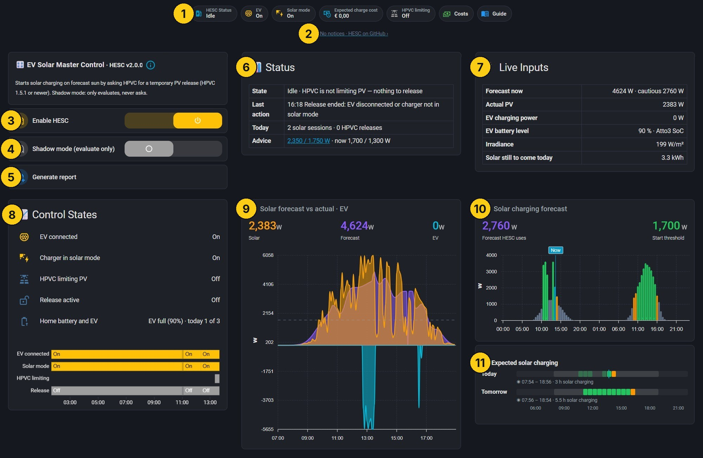
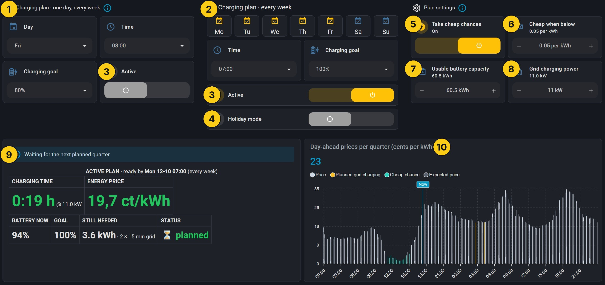
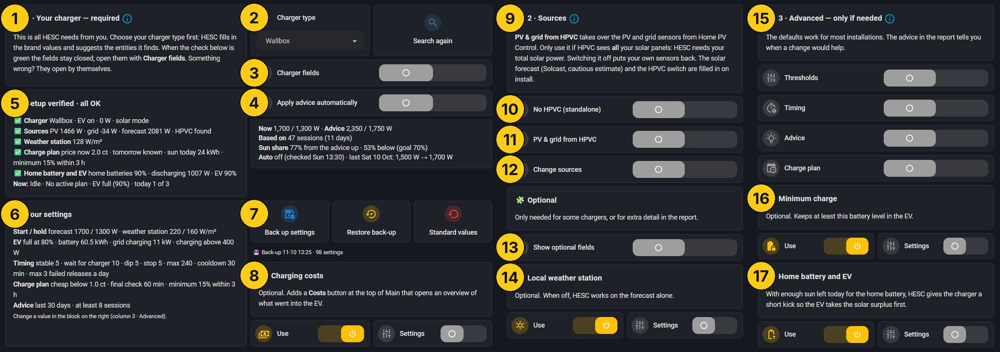
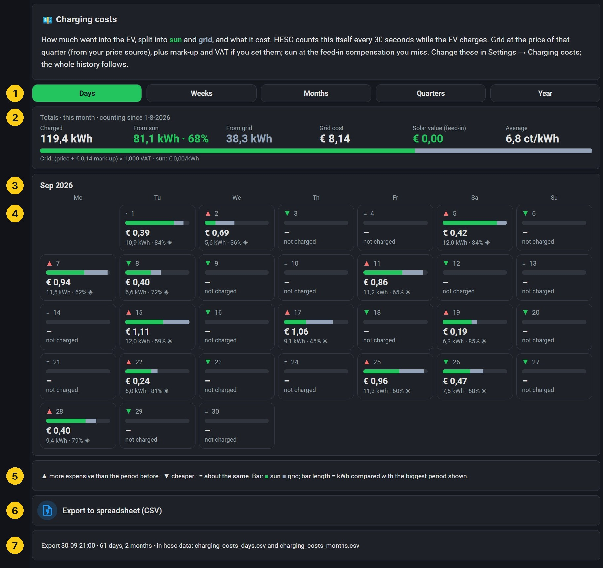

# Het dashboard uitgelegd

*Wat elk genummerd onderdeel van het HESC-dashboard doet.* (English: [The dashboard explained](08-dashboard.md))

Het HESC-dashboard heeft drie tabbladen, het **hoofdscherm**, het **laadplan** en de **instellingen**, plus de **kostenpagina**, die je opent met het kadertje *Costs* op het hoofdscherm. Hieronder staat per scherm een genummerde screenshot met per nummer een korte uitleg.

## Hoofdscherm

1. **Statusbalk:** in één oogopslag wat HESC doet, of de auto is aangesloten, of de laadpaal op zonneladen staat en of HPVC de panelen afknijpt. *Expected charge cost* toont wat het actieve plan naar verwachting kost aan netstroom, in de munt van je prijzen. *Costs* opent de kostenpagina (als die in Settings aan staat), *Guide* opent de uitleg, ook in het Nederlands.
2. **Meldingenregel:** *✓ No notices*, of wat je aandacht nodig heeft, met de tijd: rood = het laaddoel komt in gevaar (ook naar je telefoon), oranje = een sensor ontbreekt maar HESC werkt door, grijs = ter info. Tik erop om naar de plek te gaan waar je iets kunt doen; zonder melding opent hij de HESC-pagina op GitHub.
3. **Enable HESC:** de hoofdschakelaar. Uit betekent dat HESC niets meer beoordeelt. Had HESC HPVC uitgezet, dan zet het HPVC eerst terug.
4. **Shadow mode:** HESC beoordeelt en logt alles, maar schakelt niets. Begin hier altijd mee.
5. **Generate report:** maakt een rapport met alles wat HESC gemeten en besloten heeft, inclusief advies. Daarna verschijnt de knop *View report*.
6. **Status:** wat HESC nu doet, de laatste actie, de zonsessies en HPVC-vrijgaven van vandaag, en het advies voor de startdrempel uit je eigen geschiedenis naast de drempel van nu. Tik op het advies om naar Settings te gaan.
7. **Live Inputs:** de waarden waarmee HESC nu rekent: de zonvoorspelling (en de voorzichtige schatting waarop HESC beslist), de werkelijke opbrengst van je panelen, het laadvermogen van de auto, de accustand van de auto en waar die vandaan komt, de instraling van het weerstation en de zon die vandaag nog komt.
8. **Control States:** of de auto is aangesloten, de laadpaal op zonneladen staat, HPVC afknijpt en er een vrijgave loopt, met daaronder een tijdlijn. Staat *Home battery and EV* aan en hangt de auto aan de laadpaal, dan toont een extra regel de thuisbatterijen, hun laadvermogen, de accustand van de auto en wat de kickstart doet.
9. **Zonvoorspelling tegenover werkelijkheid:** paars is de voorspelling, oranje de werkelijke opbrengst, blauw (onder de nullijn) wat de auto laadde.
10. **Solar charging forecast:** de verwachte zon voor vandaag en morgen. Groen betekent genoeg zon om te starten, oranje genoeg om door te laden, grijs te weinig. Het getal links is de voorspelling waarmee HESC rekent.
11. **Expected solar charging:** wanneer de auto vandaag en morgen naar verwachting op zon kan laden, en hoeveel uur.

## Laadplan

1. **Eén dag, elke week:** kies een dag, een tijdstip en een laaddoel, bijvoorbeeld 100% op vrijdag om 08:00. Het plan komt elke week terug op die dag en tijd.
2. **Weekplan:** vink de dagen aan en kies een tijdstip en een laaddoel, bijvoorbeeld 80% op werkdagen om 07:00.
3. **Active:** zet een plan aan of uit. Elk plan heeft een eigen schakelaar. Staan ze allebei aan, dan gaat het vroegste voor.
4. **Holiday mode (vakantiemodus):** het weekplan rust terwijl je weg bent; het dagplan blijft werken en laden op zon gaat door. Staat hij aan, dan verschijnt *Holiday until*: de dag na die datum gaat hij vanzelf uit.
5. **Take cheap chances:** laadt ook zonder plan zodra de prijs onder de grens zakt, tenzij de zon die dag naar verwachting genoeg levert. Zonder plan laadt hij tot *EV counts as full at*.
6. **Cheap when below:** de prijsgrens voor een goedkope kans, per kWh in de munt van je prijzen.
7. **Usable battery capacity:** hoeveel kWh je auto echt kan gebruiken. Daarmee rekent HESC uit hoeveel energie er nodig is.
8. **Grid charging power:** hoeveel kW je laadpaal van het net levert. Daarmee rekent HESC uit hoeveel kwartieren er nodig zijn.
9. **Planstatus:** wat HESC nu doet, voor welk plan en tot wanneer, hoe lang het laden duurt, de gemiddelde stroomprijs, de accustand nu, het doel, wat er nog nodig is (en hoeveel daarvan de zon naar verwachting levert) en de status.
10. **Prijsgrafiek:** de stroomprijs per kwartier voor vandaag en morgen, in de kleine eenheid van je munt (cent, öre, øre, pence). Oranje is gepland laden van het net, blauwgroen een goedkope kans, grijs een verwachte prijs.

## Instellingen

1. **Stap 1, je laadpaal:** het enige deel dat je zelf moet invullen.
2. **Charger type en Search again:** kies je merk. HESC vult de waarden voor dat merk in en zoekt de entiteiten die erbij horen. *Search again* zoekt opnieuw.
3. **Charger fields:** opent de velden van de laadpaal (auto aangesloten, laadvermogen, de laadstand en de waarde die zonneladen betekent). Zolang de controle klopt, blijven ze dicht; klopt er iets niet, dan gaan ze vanzelf open.
4. **Advies:** het advies voor de startdrempel uit je eigen geschiedenis: de drempel van nu, het advies, op hoeveel sessies het rust en het aandeel zon erboven en eronder. *Apply advice automatically* (standaard uit) laat HESC de drempel in kleine stappen naar het advies schuiven.
5. **Controle:** één regel per onderdeel met een vinkje en de waarden van nu. Een onderdeel dat niet klopt, klapt open en zegt wat er ontbreekt; wat je niet gebruikt, staat samen op één regel.
6. **Your settings:** je drempels, EV, tijden, laadplan en advies in één oogopslag. Aanpassen doe je in stap 3.
7. **Back up settings, Restore back-up, Standard values:** een back-up van alle HESC-instellingen, die terugzetten, of alleen de afstelling terugzetten naar standaard (eerst automatisch een back-up). De regel eronder toont de laatste back-up.
8. **Charging costs (laadkosten):** *Use* toont het kadertje en de kostenpagina; *Settings* toont de waarde van een zon-kWh, *all-in*, of opslag en btw.
9. **Stap 2, bronnen:** waar HESC zon, net en de zonvoorspelling vandaan haalt.
10. **No HPVC (standalone):** zet dit aan als je geen HPVC gebruikt. HESC slaat dan de vrijgave over en je kiest zelf je sensoren voor zon en net.
11. **PV & grid from HPVC:** neemt de sensoren voor zon en net over van HPVC. Gebruik dit alleen als HPVC al je panelen ziet. Uit zet je eigen sensoren terug.
12. **Change sources:** opent de sensoren voor zon en net (en of je netmeter teruglevering positief telt), de zonvoorspelling en de HPVC-onderdelen. Klopt er iets niet, dan gaan ze vanzelf open.
13. **Show optional fields:** extra velden voor sommige laadpalen of voor meer detail in het rapport, zoals de accustand van de auto en *EV counts as full at*.
14. **Weerstation:** *Use* zet het weerstation aan of uit, *Settings* toont de sensor en de drempels. Zonder weerstation werkt HESC alleen op de voorspelling.
15. **Stap 3, geavanceerd:** drempels (en de optionele startdrempel per seizoen), timing, advies en de instellingen voor het laadplan: start/stop-schakelaar, *Back to solar mode*, prijsbron, prijssensor, prijzen per, munt, telefoons voor meldingen en het ochtendoverzicht. De standaardwaarden werken voor de meeste installaties.
16. **Minimumlading:** houdt de auto op minimaal een gekozen accustand, standaard 20% binnen 3 uur, in de goedkoopste kwartieren. Zet het aan met *Use*.
17. **Thuisbatterij en EV:** met een thuisbatterij krijgt de auto zijn deel van de zon voordat de thuisbatterij alles pakt. Zet het aan met *Use* en vul je thuisbatterij in onder *Settings*.

## Kosten

Open je met het kadertje *Costs* op het hoofdscherm, als *Charging costs* in Settings aan staat. Het voorbeeld toont een voorbeeldmaand.

1. **Periode:** dagen (een kalender van de maand), weken, maanden, kwartalen of het jaar.
2. **Totalen:** wat er deze maand in de auto ging, van de zon en van het net, de netkosten, de waarde van de zon-kWh (de terugleververgoeding die je misliep) en het gemiddelde per kWh. De regel eronder laat zien hoe de netprijs is berekend (opslag en btw, of all-in).
3. **Kalender:** één tegel per dag. Dagen van vóór de start van de telling tonen *no data yet*.
4. **Dagtegel:** ▲ duurder of ▼ goedkoper dan de dag ervoor, een balk met zon (groen) en net (grijs) waarvan de lengte de kWh toont, de kosten, en de kWh met het aandeel zon.
5. **Legenda:** wat de pijlen en de balk betekenen.
6. **Export to spreadsheet (CSV):** schrijft twee bestanden, per dag en per maand, die je in Excel opent. Scheidingsteken en decimaalteken volgen je land.
7. **Laatste export:** wanneer, hoeveel dagen en maanden, en de bestandsnamen.

Meer uitleg: [Slim laden uitgelegd](07-smart-charging-explained.nl.md)
